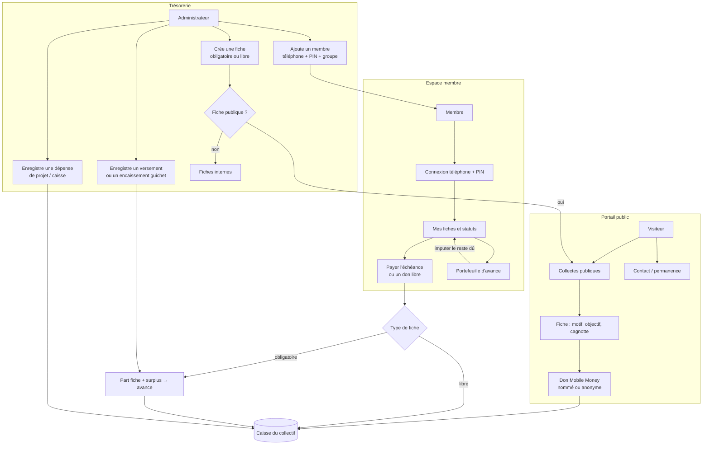
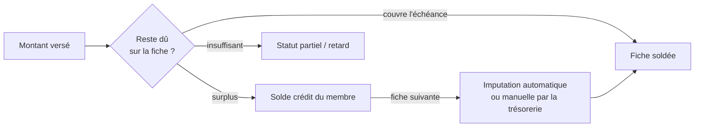

# roundPay

Plateforme de **tontines**, **cagnottes solidaires** et **cotisations mutuelles**.

roundPay n’est pas un réseau social d’inscription ouverte. C’est l’outil d’un **collectif** : la trésorerie ouvre les comptes, les membres règlent leurs fiches, le public peut soutenir les collectes visibles — chaque euro reste **traçable**.

> *L’entraide transparente et l’impact communautaire au cœur de nos initiatives.*

---

## Idéologie

### 1. La caisse appartient au collectif

L’argent n’est pas « déposé chez roundPay ». Il circule dans une **caisse communautaire** : cotisations obligatoires, dons libres, avances de membres, dépenses de projet. Le bureau (trésorier, responsables) en rend compte ; les contributeurs voient le motif, l’objectif et l’état de la cagnotte.

### 2. Pas d’inscription publique

L’espace membre n’est pas un funnel d’acquisition. On n’y entre que si un **administrateur ajoute la personne** (téléphone + PIN). Le portail public, lui, n’exige aucun compte : on peut lire une fiche et contribuer en Mobile Money, y compris de façon anonyme.

Cela sépare clairement deux gestes :

| Gestes | Qui | Condition |
| --- | --- | --- |
| Cotiser à une fiche de groupe | Membre | Compte créé par la trésorerie |
| Soutenir une collecte ouverte | Tout le monde | Fiche marquée publique |
| Gérer caisse, membres, fiches | Admin / trésorier | Identifiants bureau |

### 3. Deux natures de contribution

- **Fiche obligatoire** — échéance, montant imposé, statut (à jour, partiel, retard, payé d’avance). C’est la discipline de la tontine.
- **Fiche libre** — don, collecte, projet. Le montant est choisi. Elle peut rester interne ou être publiée sur le portail.

Une fiche publique porte une **présentation explicative** : pourquoi on collecte, à qui ça sert, comment les fonds sont suivis.

### 4. Payer maintenant, avancer demain

Tout surplus sur une cotisation obligatoire n’est pas « perdu » ni laissé flou : il alimente le **portefeuille d’avance** du membre (`solde crédit`). Ce solde peut ensuite **imputer** une prochaine échéance, sans nouveau virement.

Le paiement est ventilé :

```
montant versé  →  part qui solde la fiche  +  part créditée en avance
```

### 5. Mobile Money d’abord, traces ensuite

Les versements passent par les réseaux du quotidien (Orange Money, Wave, M-Pesa, Airtel, MTN, ou encaissement guichet). roundPay enregistre la **référence**, le réseau, le montant et l’affectation — pas le secret PIN Mobile Money.

### 6. Transparence sans exhibition

Le public voit les collectes ouvertes, les montants agrégés, le contact du secrétariat. Les membres voient **leurs** fiches, reçus et avance. Le bureau voit la **caisse entière** (collecté, dépensé, crédits d’avance, retards). Un donateur peut rester anonyme sur la fiche publique.

---

## Trois espaces

```
Portail public          Espace membre              Administration
(sans compte)           (téléphone + PIN)          (identifiant bureau)
     │                        │                           │
     ├─ Collectes ouvertes    ├─ Mes fiches               ├─ Membres & groupes
     ├─ Fiche + don           ├─ Payer / avance           ├─ Fiches & visibilité
     └─ Contact / permanence  └─ Profil, historique       ├─ Versements & caisse
                                                          └─ Portail & contact
```

- **Public** (`/`, `/fiche/:id`, `/contact`) — lecture et don.
- **Membre** (`/login` → `/client/dashboard`) — cotiser, consulter l’avance, l’historique.
- **Admin** (`/admin/login`) — créer les membres, ouvrir les fiches, enregistrer les paiements, publier ou retirer une collecte, tracer les dépenses.

Application **PWA** : installable, usage hors-ligne pour relire ses reçus, session locale chiffrée.

---

## Diagramme d’action

Vue d’ensemble : qui fait quoi, et où l’argent va.



### Ventilation d’un paiement obligatoire



### Parcours types

1. **Soutenir sans compte** — ouvrir le portail → choisir une fiche publique → lire l’explication → contribuer via Mobile Money → la cagnotte et le journal des versements se mettent à jour.
2. **Devenir membre** — le trésorier crée la fiche d’identité (nom, téléphone, PIN, groupe, éventuellement une avance initiale) → le membre se connecte sur `/login` → il voit ses cotisations.
3. **Régler une tontine** — le membre ouvre la fiche due → paie l’échéance exacte, ou l’échéance + 1 / 2 mois → le surplus crédite l’avance → plus tard, il peut « régler avec mon solde ».
4. **Tenir la caisse** — le bureau ouvre / clôture les fiches, encaissse au guichet, impute les crédits, publie une collecte, consigne une dépense : le solde de caisse = collecté − dépensé, avec les avances membres suivies à part.

---

## Rôles

| Rôle | Intention |
| --- | --- |
| **Membre** | Cotiser, suivre son avance, lire ses reçus. |
| **Responsable de groupe** | Relais de tontine (assigné par le bureau). |
| **Administrateur / trésorier** | Gouvernance de la caisse, des membres et du portail. |
| **Contributeur public** | Soutenir sans adhérer. |

---

roundPay sert une idée simple : **l’entraide se gère comme une caisse commune**, pas comme un compte personnel — ouverte à la solidarité, fermée à l’inscription sauvage, lisible euro par euro.
